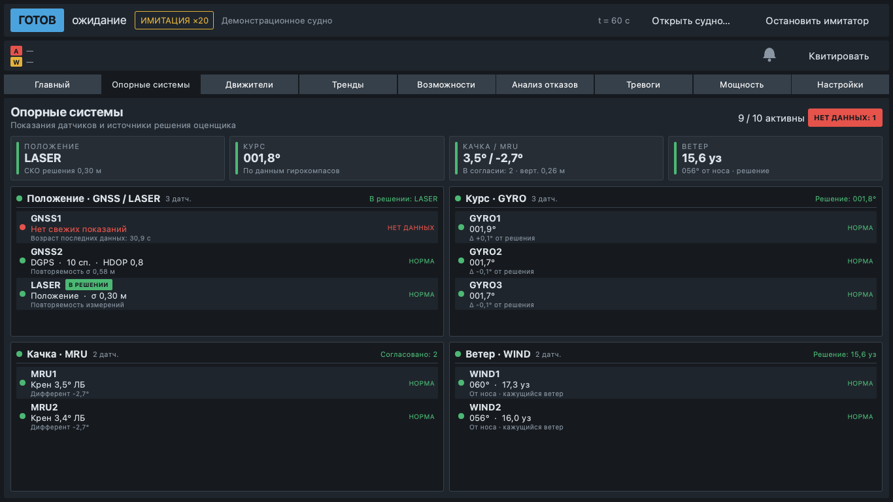
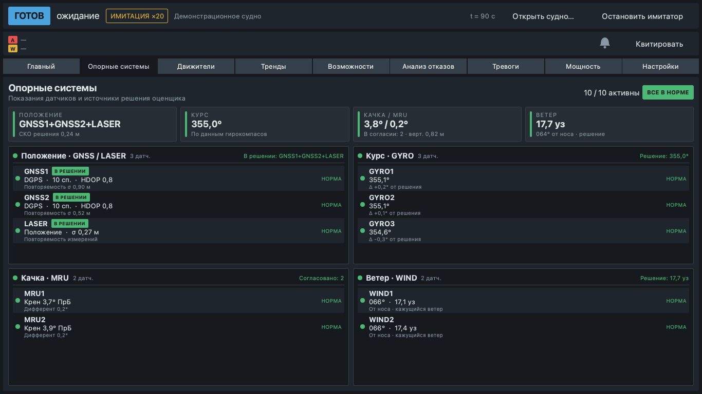

# Проверка отказа и восстановления GNSS1

Проверена реакция вкладки **«Опорные системы»** на штатную команду имитатора `sim off GNSS1` и последующее восстановление командой `sim on GNSS1`.

Условия: демонстрационное судно, быстрый имитатор, ночная палитра, окно 1366×768. Проверка выполнена на Mac в безэкранном режиме Qt со снятием итоговых изображений. Код ядра и пульта не изменялся.

## Отказ GNSS1

Команда запуска:

```bash
QT_QPA_PLATFORM=offscreen QT_QUICK_BACKEND=software LC_ALL=ru_RU.UTF-8 ./build/hmi/sdp_hmi --ship "$PWD/data/Данные_судна_пример.xlsx" --sim "$PWD/tests/scenarios/имитатор_быстро.xlsx" --run 30 --cmd "sim off GNSS1" --run 30 --tab 1 --palette night --size 1366x768 --screenshot "$PWD/build/опорные_отказ_GNSS1.png"
```

Команда завершилась успешно. На снимке подтверждено:

- источник решения положения изменился на **«LASER»**;
- сводка показывает **«9 / 10 активны»** и красное **«НЕТ ДАННЫХ: 1»**;
- строка GNSS1 красная: **«Нет свежих показаний»**, возраст последних данных — **30,9 с**;
- GNSS2 остаётся в состоянии **«НОРМА»**, но не отмечен **«В РЕШЕНИИ»**;
- LASER отмечен **«В РЕШЕНИИ»**.

Таким образом, в проверенном сценарии решение переключилось только на LASER, а не на GNSS2+LASER. Это фактическое поведение текущей версии; логика оценщика не изменялась. Общие показатели A/W в шапке остаются **«—»**, поэтому результат относится к локальному предупреждению на экране опорных систем, а не к отдельной аварии менеджера тревог.



## Восстановление GNSS1

Команда запуска:

```bash
QT_QPA_PLATFORM=offscreen QT_QUICK_BACKEND=software LC_ALL=ru_RU.UTF-8 ./build/hmi/sdp_hmi --ship "$PWD/data/Данные_судна_пример.xlsx" --sim "$PWD/tests/scenarios/имитатор_быстро.xlsx" --run 30 --cmd "sim off GNSS1" --run 30 --cmd "sim on GNSS1" --run 30 --tab 1 --palette night --size 1366x768 --screenshot "$PWD/build/опорные_возврат_GNSS1.png"
```

Команда завершилась успешно. После восстановления на снимке подтверждено:

- снова **«10 / 10 активны»** и **«ВСЕ В НОРМЕ»**;
- источник решения положения — **«GNSS1+GNSS2+LASER»**;
- GNSS1, GNSS2 и LASER отмечены **«В РЕШЕНИИ»**;
- красное предупреждение GNSS1 исчезло.



## Итог

Индикация отказа и восстановления работает: при отказе GNSS1 появляется локальное предупреждение, а решение переключается на LASER; после восстановления все три источника возвращаются в решение. Отдельно зафиксировано, что исправный GNSS2 не использовался в решении при отказе GNSS1. Автоматический тест в этой проверке не добавлялся.
