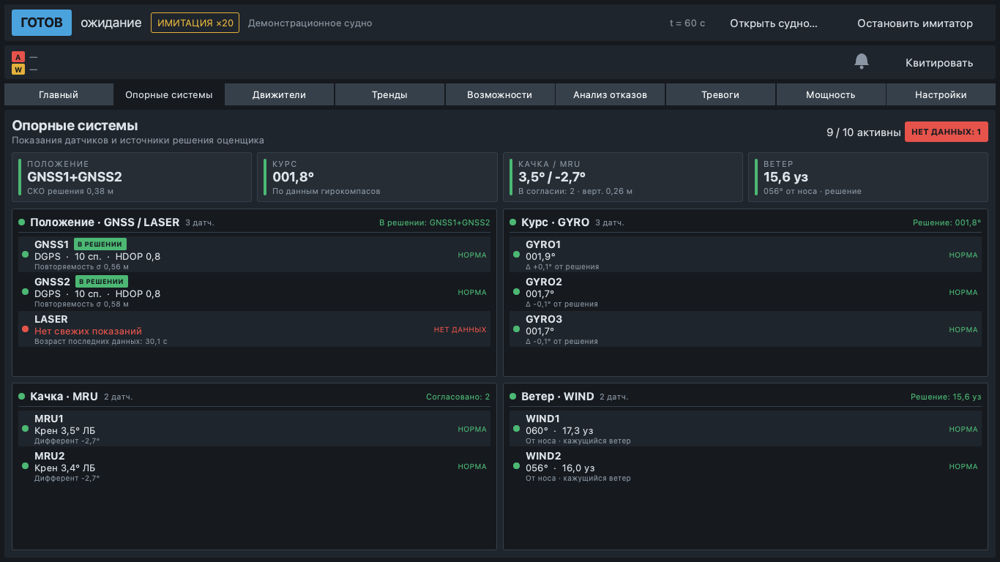
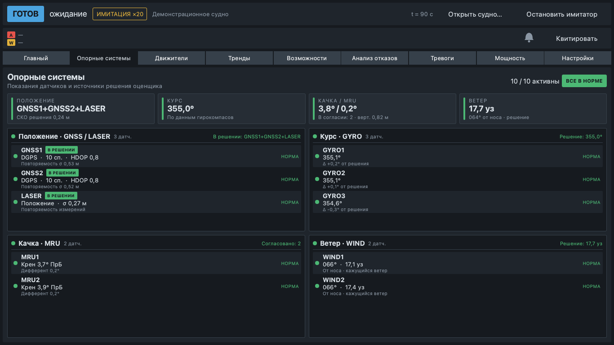

# Проверка отказа и восстановления LASER

Проверена реакция вкладки **«Опорные системы»** на штатную команду имитатора `sim off LASER` и последующее восстановление командой `sim on LASER`.

Условия: демонстрационное судно, быстрый имитатор, ночная палитра, окно 1366×768. Проверка выполнена на Mac в безэкранном режиме Qt со снятием итоговых изображений. Код ядра и пульта не изменялся.

## Отказ LASER

Команда запуска:

```bash
QT_QPA_PLATFORM=offscreen QT_QUICK_BACKEND=software LC_ALL=ru_RU.UTF-8 ./build/hmi/sdp_hmi --ship "$PWD/data/Данные_судна_пример.xlsx" --sim "$PWD/tests/scenarios/имитатор_быстро.xlsx" --run 30 --cmd "sim off LASER" --run 30 --tab 1 --palette night --size 1366x768 --screenshot "$PWD/build/опорные_отказ_LASER.png"
```

Команда завершилась успешно. На снимке подтверждено:

- источник решения положения изменился на **«GNSS1+GNSS2»**;
- сводка показывает **«9 / 10 активны»** и красное **«НЕТ ДАННЫХ: 1»**;
- строка LASER красная: **«Нет свежих показаний»**, возраст последних данных — **30,1 с**;
- GNSS1 и GNSS2 отмечены **«В РЕШЕНИИ»**.

Общие показатели A/W в шапке на этом снимке остаются **«—»**. Результат относится к красному предупреждению на экране опорных систем и изменению источника решения, а не к отдельной аварии менеджера тревог.



## Восстановление LASER

Команда запуска:

```bash
QT_QPA_PLATFORM=offscreen QT_QUICK_BACKEND=software LC_ALL=ru_RU.UTF-8 ./build/hmi/sdp_hmi --ship "$PWD/data/Данные_судна_пример.xlsx" --sim "$PWD/tests/scenarios/имитатор_быстро.xlsx" --run 30 --cmd "sim off LASER" --run 30 --cmd "sim on LASER" --run 30 --tab 1 --palette night --size 1366x768 --screenshot "$PWD/build/опорные_возврат_LASER.png"
```

Команда завершилась успешно. После восстановления на снимке подтверждено:

- снова **«10 / 10 активны»** и **«ВСЕ В НОРМЕ»**;
- источник решения положения — **«GNSS1+GNSS2+LASER»**;
- LASER снова отмечен **«В РЕШЕНИИ»**, красное состояние исчезло.



## Итог

Ожидаемое поведение подтверждено: при отказе одного датчика пульт показывает локальное предупреждение и исключает LASER из решения; после восстановления датчик возвращается в решение, а индикация нормализуется. Автоматический тест в этой проверке не добавлялся.
